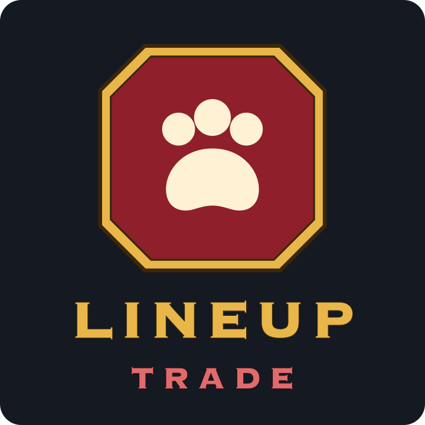

<p align="center"></p>

# Lineup Trade

A World of Warcraft (Retail) addon for trading pet battle PvP wins at community events. Players
queue for PvP pet battles at the same time; Lineup Trade decides in each battle who wins and who
loses, so everyone in the event gets their share of wins.

This addon is separate from [Lineup](https://github.com/remul/Lineup) and doesn't need it.

**Status:** early development. The trading itself isn't in yet.

## Installation

Download the zip from the [releases](https://github.com/remul/Lineup_trade/releases), copy the
`Lineup_trade` folder into `World of Warcraft/_retail_/Interface/AddOns/` and restart the game.

## Commands

| Command               | Description                   |
|-----------------------|-------------------------------|
| `/lineup_trade`       | Open the window               |
| `/lineup_trade debug` | Turn debug messages on or off |

## How it works

- In the window, enter the **event key** (the same word for everyone in the event), your **wins
  goal** and the **pet family** the event uses, then click **Start**.
- Start puts your three best pets of that family into the battle slots and renames the first one to
  your trade code, e.g. `LtAKZRMAFTQP`. In a PvP pet battle, the code is how Lineup Trade recognises
  a trade partner. It holds:
  - your ID, made from your character name and realm, so it never changes for that character;
  - your balance (wins minus losses), the number of trade games you've played and whether
    you're a helper (see below);
  - a checksum of the event key, so only players with the same key are accepted.
- **Wins goal and helpers:** once your wins reach your goal, you become a helper. Your code says so,
  and you lose every game against players who haven't reached their goal yet, so they get their
  wins faster. Two helpers play it out like everyone else. A goal of 0 means no goal.
- Each player remembers the newest code they've seen of everyone. A code with fewer games than
  seen before (a reset or a copied code) isn't trusted again for that event.
- **Trade key:** set it in Options > Keybindings > AddOns > Lineup Trade. Out of battle it queues
  for a PvP pet battle and accepts the match; in battle it forfeits when you're the one to lose,
  and does nothing when you win. The decision is shown at the top of the screen in each battle.
  Results against trade partners are counted, and your pet's name is updated after the battle.
- Stop gives the pet its own name back. Wins and losses are kept per event key and per character,
  and survive logouts and disconnects. After a crash, your record is read back from your pet's
  name, which the server keeps up to date.

## Languages

Lineup Trade uses the language of your game client. English, German, French, Italian and Russian
are available. Translations are in `Locales/`.

## Development

Lineup Trade is Lua with no build step. Link the repository into the AddOns folder and use
`/reload` in game to load changes:

```sh
ln -s "$(pwd)" "/Applications/World of Warcraft/_retail_/Interface/AddOns/Lineup_trade"
```

Releases are built by the [BigWigs packager](https://github.com/BigWigsMods/packager) (see
`.pkgmeta`) when a version tag is pushed, and published as GitHub releases. Before tagging, set
`## Version` in `Lineup_trade.toc` to the same version. Changes are listed in
[CHANGELOG.md](CHANGELOG.md).

## License

[MIT](LICENSE)
